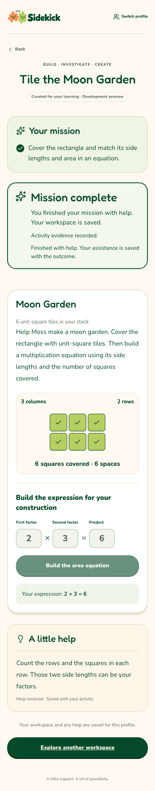
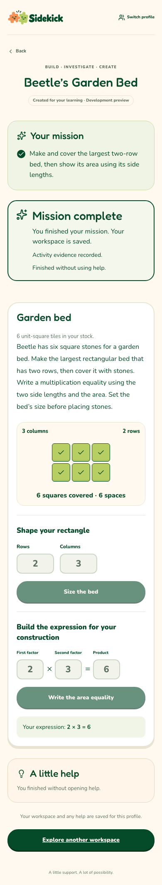
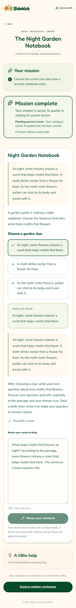
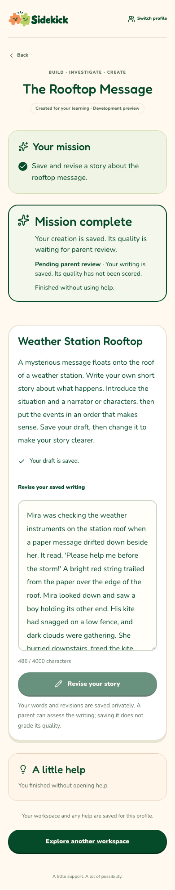
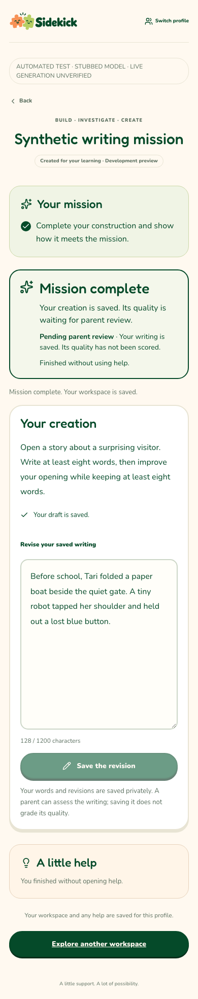

# Activity Engine V2: live composition in the development preview

An authenticated child can upload schoolwork, receive a server-built learning
intent and open an original AI-composed ActivityProgram in the existing shared
workspace. The normal V1 activity path remains separate and unchanged. This is
an opt-in development feature, not full-catalog readiness or evidence of learning
effectiveness.

## Local entry points

Keep the existing provider configuration in `backend/.env`:

```dotenv
VISION_API_KEY=<existing key>
VISION_MODEL=<configured model>
VISION_BASE_URL=<existing OpenAI-compatible base URL>
APP_ENV=development
```

No credentials belong in `NEXT_PUBLIC_*`. No new key or dependency is introduced.
Retain the rest of the account, database and private-upload configuration.

```sh
npm run db:migrate
SIDEKICK_ACTIVITY_V2_PREVIEW=true npm run dev:all
```

Open **http://localhost:3000/kid/homework**, sign in and choose a child. Upload a
photo/PDF, tap **Read my work**, then **Create an activity** in the development
preview card. The child does not select a skill or a game. The existing V1
**Try an activity** remains available. `SIDEKICK_ACTIVITY_V2_PREVIEW` defaults
off, and production refuses the V2 endpoints even when the flag is set.

The durable progress URL is `/kid/activity-preview/generations/{generationId}`.
It survives refresh and opens `/kid/activity-preview/{sessionId}` when ready.
The list at **http://localhost:3000/kid/activity-preview** recovers owned jobs and
saved generated work, with the original fixtures separately labeled as
hand-authored development examples.

Live verification is complete for all four cases below. Initial writing uploads
stopped when the configured provider reported `credit_balance_exhausted` (HTTP
429). After credits were restored, an explicit retry completed real extraction,
composition, separate review, browser play, refresh and replay. Prior failed
attempts remain recorded. Reading and writing quality remain pending parent
review; successful engineering verification is not an assessed language success.

## Trusted learning information

[`context.py`](../backend/activity_engine_v2/context.py) resolves a completed,
owned upload and reliably mapped K–5 target. It pins the exact catalog
demonstration and supported grading confidence. A reliable ungraded mapping
supports exploration; it never becomes incorrect evidence. Teacher conflicts,
uncertain text, weak mappings and unsupported correctness judgments abstain.

Matched error-pattern observations can support a confidence-qualified catalog
hypothesis only when the saved signature and grade support it. Catalog
misconceptions alone are not facts about a child. The context explicitly retains
uncertainty rather than inventing a strategy, prerequisite diagnosis or confidence.

Relevant authorized V1/V2 history supplies actual completion, assessment and help
use. Previous operation/component signatures invite variation in actions and
reasoning for the same skill. History has no invented confidence or mastery label.
The composer receives these sanitized categories and curriculum data; original
question wording, student answers, images, names, emails, account/profile/upload
IDs and private paths are excluded. Actual source references remain private in
the owned generation record.

## A closed authoring format, one runtime language

The existing shared `structured_call` transport still uses the configured
`VISION_*` settings. An optional metadata dictionary records only requested and
returned model identifiers. Existing V1 callers retain their response behavior.

[`ActivityAuthoring`](../backend/activity_engine_v2/authoring.py) replaces dynamic
object bindings and witness-input maps with explicit typed entries. Duplicate
or unknown ports/input names reject. Disjoint tagged unions use provider-compatible
`anyOf` without discriminator annotations. The actual provider-facing schema is
tested after the shared strict-schema transform: all objects are closed, required
fields are explicit and no dynamic map is silently erased.

Material variants encode their actual contracts: unit tiles have a quantity and
empty text/items, prompts have text without quantity, and passages contain real
literal sentence items. Goal predicates and automatic-assessment predicates
recursively exclude goal references, as the authoritative validator requires.
These authoring restrictions prevent repeated invalid combinations while
compiling unchanged into the existing runtime language.

Compilation deterministically produces the authoritative ActivityProgram. It
checks exact target echoes and injects trusted observations, hypotheses and
honest AI provenance server-side. Authoring is never interpreted by the child
player; the existing `ExecutionCore` remains the only execution language.

## Admission before play

The model receives the six implemented operations and their real semantic ports,
materials, shared-state connections, constraints and assessment boundaries. It
chooses the purpose, starting world, actions, rules, help and mission. No finished
fixture is selected or silently substituted. No skill permanently selects one
game or interaction family.

A candidate must pass all of these gates:

1. Authoritative schema, reference, type, material, state and computational checks.
2. Runtime/renderer compatibility through the same factored gate as examples.
3. An explicitly nonempty finish witness verified by `ExecutionCore`, including
   its individual-move budget. `check_witness=True` alone is insufficient.
4. Separate semantic review of that exact canonical definition hash: concept
   necessity, meaningful consequences, complete materials, achievable finish,
   relevant help, correct scoring across allowed routes, shortcuts and parent
   assessment requirements.

Initial automatic criteria must not already be satisfied; the checked finish
must agree with applicable automatic assessment. Review is still a model judgment,
not a proof of educational effectiveness or every possible route. The shared
review gate is rechecked at trusted session admission. The final trusted intent
must match the pinned context. Repairs produce new candidates, then repeat all
validation and exact-hash review; earlier approval cannot carry over.

Only an approved immutable definition starts a session. It starts at its declared
initial state with zero child actions/events. The private witness is never replayed
into that session, displayed to the child or treated as learner evidence.

## Boundaries, recovery and privacy

Migration `009` adds owned generation jobs/request aliases, pinned private context
and source references, safe stage/reason metadata and exact-definition approval.
The existing immutable versions/sessions/events/replay store the admitted program.
No V1 session or history is rewritten. Profile/account/upload deletion cascades
generation-source records; owned runtime history retains its existing boundaries.

Each job permits at most three candidates and six compose/review calls inside
a 360-second total deadline. Provider calls never hold a database transaction.
Ownership, active child, profile version and source ownership are checked again
between stages and after provider work. Source deletion or a profile switch
prevents admission. Strict browser request models do not accept a learning context
or program definition.

Request IDs are idempotent. Another request for the same in-flight upload aliases
the existing job. Identical retries, refresh and uncertain HTTP responses recover
the saved job rather than duplicate generation. Failed jobs release reservations
and offer a new explicit retry. This prototype uses bounded in-process background
tasks: process loss leaves a lease that expires after 420 seconds, then retry is
available. It is not a durable external worker queue.

Returning to an old failed URL after its retry was accepted recovers the newer
processing/ready attempt without another model call. Older ready work cannot mask
a later failed new activity. These relationships use owned transaction ordering,
including when timestamps are identical.

Safe provider/schema/capability/witness/scoring/review codes describe failure.
Candidate bodies, private work, provider payloads and credentials stay out of logs
and child error responses. Requested/returned models and bounded repair reason
codes are retained privately for verification. Public sessions still omit hidden
material, internal observations, witnesses and private grading predicates/keys.
Existing account cookies, CSRF/origin, active-child and profile-version protections
apply; parent PIN protection is unchanged.

## Current capability and outcome limits

The implemented preview actions are unit tiling, rectangle reshaping, multiplication
construction, literal passage-evidence placement and actual text creation/revision.
Adapters accept the existing bounded shared-object shapes. Other registry operations
and arbitrary component combinations remain unavailable. A mapped skill without a
truthful supported interaction fails admission; no decorative card or finished
example replaces it.

Mission completion, assessment and assistance stay separate. Exploratory moves
are not individually marked wrong. Delivered help persists. Writing can finish
while quality remains pending parent review; word count or artifact existence
does not establish quality. V2 parent review UI, mastery, support-state clearing,
next-activity selection and learning effectiveness are outside this milestone.

## Reproduce verification

The ordinary automated suites use explicit provider stubs, real APIs and disposable
storage. They exercise closed-schema compilation, admission, durable generation,
privacy, replay and browser interaction without spending provider credits:

```sh
backend/.venv/bin/python -m pytest backend/tests -q --tb=short \
  -o tmp_path_retention_policy=failed -o tmp_path_retention_count=1
npx playwright test --config playwright.activity-v2-composition.config.ts
npx playwright test --config playwright.activity-v2.config.ts
npx playwright test tests/e2e/accounts.spec.ts tests/e2e/activities.spec.ts
npm run typecheck
npm run build
```

Stop servers on ports 3000/8000 before browser commands. The separately opt-in
configured-provider browser proof is:

```sh
SIDEKICK_RUN_V2_LIVE=true npx playwright test --config playwright.activity-v2-live.config.ts
```

That proof uploads only synthetic schoolwork using real extraction/analysis,
composition and review. It starts with an empty generated/V1 library and disables
fixture loading for generation. A separate synthetic browser driver independently
uses model-planned or independently human-authored actions from the **public**
scene/materials/goals, without the admission witness or private criteria, then
uses actual React controls. Those engineering
actions are not real child evidence. The proof records generation, review, play,
assessment, assistance, refresh and replay separately; pending writing never counts
as an assessed success.

## Recorded verification

The configured requested model and every available returned model identifier were
**`gpt-6.1-terra`**. The [safe report](activity-engine-v2-composition/browser-live-report.json)
records each compose/repair/review call's model identifiers and definition hash,
without provider bodies, credentials, private source IDs or student work.

| Case | Generated, reviewed and played live | Result |
| --- | --- | --- |
| Pave the Observatory — `3.MD.C.7-1` | Yes: fixed unit tiling and a child-built product. | Objective construction demonstrated with recorded help; refresh/replay passed. |
| Beetle's Garden Bed — same subskill | Yes: choose the largest permitted two-row bed, resize, tile and construct a product. | Objective construction demonstrated without opening help; refresh/replay passed. Its context included the prior same-skill assisted outcome. |
| The Night Garden Notebook — `RI.3.1-1` | Yes: choose literal evidence, author a question and answer, then revise them. | Mission complete; quality pending parent review. Refresh/replay passed. |
| The Rooftop Message — `W.3.3-1` | Yes: create an original narrative about a message at a rooftop weather station, establish the situation/characters, order events, then revise the actual draft. | Mission complete without opening help; quality pending parent review. Refresh/replay passed. |

The proof began with empty V1/generated version tables and fixture loading disabled
on the generation path. Verification was resumed in the same isolated family/database
after rejected candidates, integration fixes and the provider-credit interruption;
completed worlds and failed attempts were preserved. The funded verification
resume passed its browser proof and the report now records **`success:true`** for
all four engineering flows. Both Math constructions have `assessedSuccess:true`;
reading and writing have `assessedSuccess:false` with `pending_parent_review`.
The writing activity was composed and separately reviewed in two provider calls
after live extraction succeeded. The Math contexts honestly used exploration
when automatic upload grading abstained. No incorrect response or strategy was
invented to obtain variety.

Live checks caught and drove fixes for incompatible material fields, forbidden goal
references, individual-move budgets, missing child-authored questioning, lost retry
navigation and visible source materials. Rejected candidates created no child session.
Reading's approved definition uses parent assessment for the original question/answer;
the writing definition also requires parent assessment of the original story and
revision. Saving words does not establish language quality. The requested and
available returned model identifiers stayed `gpt-6.1-terra` throughout the recorded
composition, repair and review calls.

Engineering checks passed: **1,640 backend tests**, the final focused composition
checks, **two stubbed generation browser flows** including an uncertain accepted response
and actual writing revisions with parent assessment pending,
**ten runtime/material browser tests**, and **twelve V1/account browser regressions**.
TypeScript and the production build pass. These are engineering
checks, not child testing or learning-efficacy evidence.

The separately funded configured-provider proof passed: **one browser proof test**
covering the four preserved live cases. It is separate from the automated stubbed
tests and does not count pending parent assessment as a successful quality judgment.

## Live screenshots

All captures contain synthetic engineering work only.









Additional explicit-stub regression evidence is retained separately:



The [writing stub report](activity-engine-v2-composition/writing-stub-report.json)
records admission, real browser text revisions, refresh and pending parent review
with an explicitly stubbed model. It supplements the completed configured-provider
writing verification above and is not presented as live model output.
