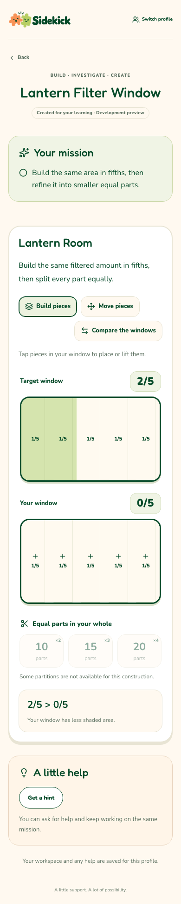
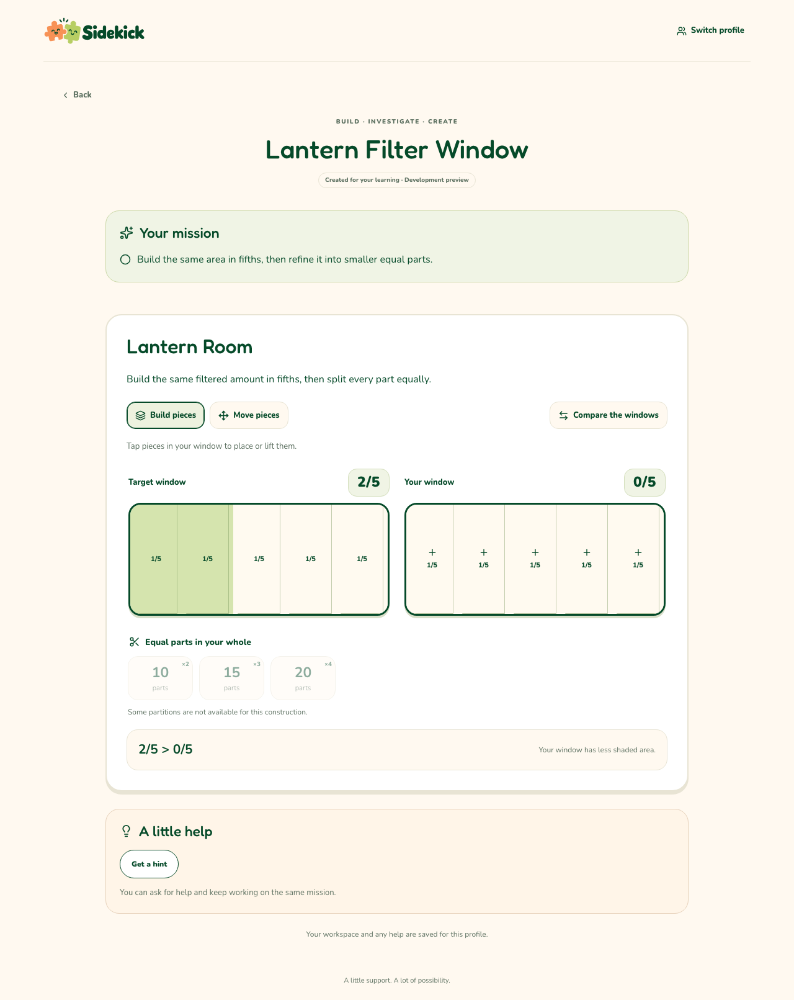
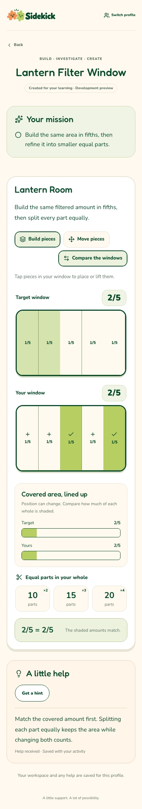
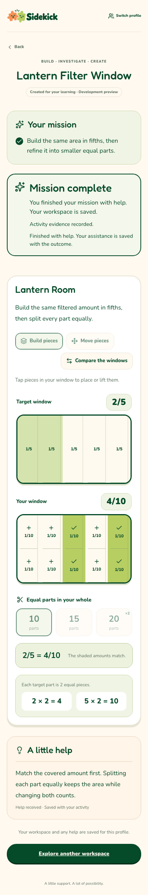
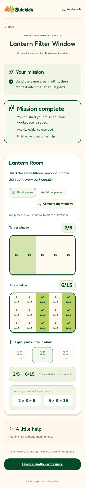

# A playable fraction-window benchmark

Open the saved **Lantern Filter Window** activity locally:

**http://localhost:3000/kid/activity-preview/1060d1bd9db24e208c05a0bacf898874**

Use the same account and child profile as the original Lantern Filter Workshop.
The saved evaluator attempt starts empty, with zero actions and no delivered help.
The URL refers to this machine's private development database; cloning the repo
does not copy accounts, uploads or saved attempts.

```sh
SIDEKICK_ACTIVITY_V2_PREVIEW=true npm run dev:all
```

The existing `backend/.env` supplies `VISION_API_KEY`, `VISION_MODEL` and
`VISION_BASE_URL`. No new key, dependency or migration is required beyond PR #11's
existing setup. The preview remains unavailable in production.

## What the child does

The reference window covers **2/5** of one whole. The child builds that amount in
their own window by placing or lifting colored pieces. They can move the pieces
to different positions and compare the total covered areas, independently of the
layout. When the amount matches, they can refine the whole into **10, 15 or 20**
equal pieces. Each existing part visibly splits without changing its shaded area.

The AI-authored goal accepts every equivalent arrangement under those refinements.
For example, two fifths become four tenths or six fifteenths. The fraction labels
and linked numerator/denominator multiplication reflect the actual construction.
One optional conceptual hint is available. The mission finishes as soon as the
constructed amount is equivalent under a finer partition. There is no essay,
numeric answer form or separate quiz.

The initial build followed by a uniform split is intentional: this benchmark
targets the existing upload's `4.NF.A.1-1` common-factor demonstration. Its
AI-authored guard requires construction before refinement. The general toolkit
can also support other action sequences; it does not permanently assign this
subskill to a window activity.

## AI composition and admission

The saved activity is an original ActivityProgram generated by the configured
provider, not a hand-authored finished game or a renamed fixture. A development
tool resolves the original owned upload, builds the existing trusted context,
and passes a separate, bounded creative brief into the ordinary reservation,
composition, repair, validation, review and persistence path.

The final selected generation requested **`gpt-6.1-terra`**; every available returned
model identifier matched. It used four calls: compose, two schema repairs and a
separate semantic review. The repairs corrected the exact fraction piece domain.
The approved definition hash is
`379df440bfa1160910091738e238615b4f15ebd5ae62f8577c30df780baa7030`.
Its private four-action witness was verified through the shared execution core,
and review is bound to that exact hash. Witnesses are never played into the child
session or used as browser answers.

An earlier generated draft added a writing-and-revision task. It was rejected as
the quality benchmark and a fresh fraction-only composition was requested. The
final activity is the reviewed benchmark, not evidence that every generation will
meet this quality level without iteration. The saved JSON and original attempt
remain immutable in local storage; the public report omits private criteria,
source identifiers, provider bodies and credentials.

## Reusable capabilities added

| Capability | Representation and trusted behavior |
| --- | --- |
| Fraction whole | `fraction_strip` binds an integer denominator and selected-piece set, with immutable whole identity and fixed base columns. |
| Build | `toggle_fraction_piece` places or removes one actual equal-area piece. No submitted numerator is trusted. |
| Rearrange | `move_fraction_piece` moves a selected piece into an empty location and conserves its amount. Touch, keyboard arrows and desktop drag share the same server action. |
| Repartition | `set_fraction_partition` uses a typed `repartition` effect. Exact rational resampling preserves the physical shaded region; incompatible mixed-cell cuts reject atomically. |
| Compare | `fraction_equal` checks declared same-whole identity and exact cross multiplication. The server projects counts, relative amounts and legal next partitions. |
| Render | `fraction_workspace` renders fixed-size paired wholes, animated divisions, movable pieces, coverage bars and coupled count relationships. It consumes declared state and actions rather than a game ID. |

Both composition and independent review receive the actual operation and renderer
contracts. Closed provider authoring compiles deterministically into the existing
runtime language. Available partition choices honor both physical constraints and
the AI-authored guards. Existing V1 behavior and historical V2 hashes/replay are
preserved; no learner-state or mastery policy is changed.

## Browser evidence

The [safe report](activity-engine-v2-fraction-benchmark/report.json) separates
generation, admission and actual browser verification. Engineering attempts use
an isolated synthetic account/database and exact copies of the approved definition.
The evaluator's original attempt remains untouched in the application database.
The browser derives its construction from public fractions and controls, without
reading the private finish witness or grading criteria.











Normal regression verification uses model stubs. The benchmark's generation used
the real configured provider; replaying its saved definition makes no model calls.
The actual browser completed two differently arranged constructions, `4/10` with
help and `6/15` without help. It verified touch and keyboard movement, fixed matching
whole dimensions, conserved physical shaded area across a split, disabled guarded
partitions, refresh, and deterministic replay. Both construction outcomes were
recorded as demonstrated; these are synthetic engineering attempts, not child data.

The full backend regression passed **1,673 tests**. Final focused checks additionally
cover the subsequent guard-aware projection, precise repair guidance, serializer
compatibility and isolated verification preparation. **24 existing browser tests**,
TypeScript, the production build, original witnesses and the capability-audit
freshness check passed.

The standalone browser command requires private synthetic verification state from
the preparation tool. Stop existing servers first; the test starts its own
isolated backend and frontend:

```sh
backend/.venv/bin/python scripts/prepare_activity_benchmark_verification.py \
  --report docs/activity-engine-v2-fraction-benchmark/report.json \
  --browser-state /tmp/new-benchmark-browser-state.json \
  --private-config /tmp/new-benchmark-verification-config.json
SIDEKICK_RUN_FRACTION_BENCHMARK=true \
SIDEKICK_BENCHMARK_CONFIG=/tmp/new-benchmark-verification-config.json \
npx playwright test --config playwright.fraction-benchmark.config.ts
```

Keep private browser state/config outside the repo. The verification preparer
creates a fresh `sidekick-benchmark-*.sqlite3` database and synthetic profile;
it does not execute test actions against the child's real history.

## Remaining limits

This is one guided benchmark, not a claim of independent arithmetic recall,
mastery, child testing, full-catalog readiness or learning effectiveness. Automatic
evidence establishes the recorded physical construction and common-factor
refinement; it does not establish an unobserved verbal explanation.

The new representation supports one rectangular whole with equal parts,
denominators from 2 to 24, fixed shared base-column geometry and one reference plus
one editable construction per component. Arbitrary shapes, unequal partitions,
fraction addition, rotations and multiple wholes are outside this extension.
Refinement/coarsening must preserve exact shaded geometry; moving pieces can make
a coarser partition unavailable. Controls stop when the saved mission finishes.
The evaluator URL remains a fresh attempt; later attempts require another owned
session. Existing in-process generation deadlines and recoverable leases remain.
