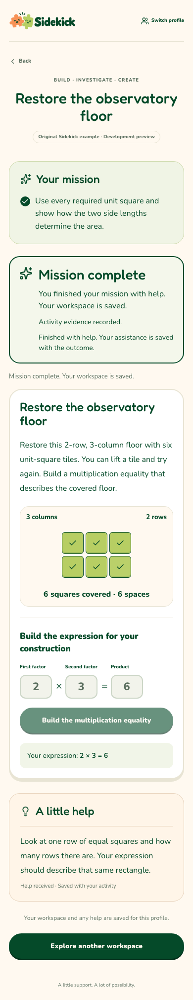
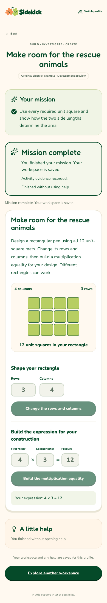
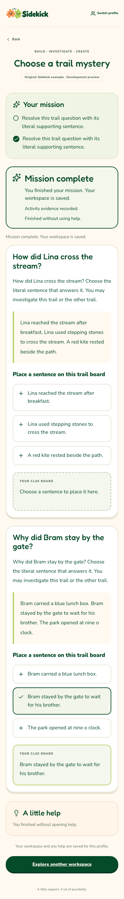
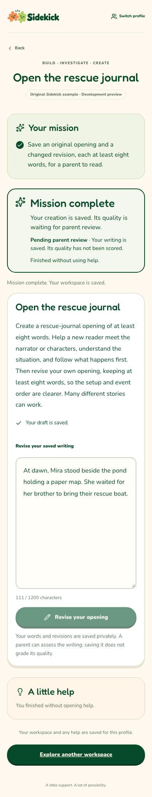

# Activity Engine V2: trusted development preview

This is a playable preview of the four hand-authored ActivityProgram fixtures.
It adds a shared trusted execution core, owned SQLite sessions and a React
workspace renderer. It does not compose AI programs, change uploaded-work skill
states, award mastery, select the next activity, or establish learning efficacy.
V1 remains the regular upload-to-activity engine and keeps its saved histories.

## Run locally

Use the existing README setup and account. After pulling this branch:

```sh
npm run db:migrate
SIDEKICK_ACTIVITY_V2_PREVIEW=true npm run dev:all
```

Open **http://localhost:3000/kid/activity-preview**, sign in and choose a child.
`APP_ENV` must be `development` or `test`. Alternatively add
`SIDEKICK_ACTIVITY_V2_PREVIEW=true` to the existing `backend/.env` and restart.
The flag defaults to false; production refuses the preview even with it set.
There are no new dependencies or model credentials. Do not replace existing
credential files. Only registered server-side fixtures can start a session.

The preview list offers Continue for a saved attempt. A session's exact address
is `/kid/activity-preview/{sessionId}`. Refresh restores accepted work, delivered
help and revision. A completed workspace remains visible and read-only. A new
API start request with a new request ID creates a distinct attempt; retrying the
same request returns the original saved result.

## What the child can do

| Workspace | Persistent action | Finish and assessment |
| --- | --- | --- |
| Observatory floor | Place/lift actual unit tiles; use the same rectangle to build a multiplication equality. | Cover the rectangle and represent its dimensions/product. Construction checks are distinct from a claim about the child's reasoning. |
| Habitat designer | Reshape rows and columns using fixed stock; construct a matching product. | Multiple factor pairs and commuted factors work. A different construction uses the same controls and rules. |
| Trail investigation | Read literal passages and place a sentence on either evidence board. | Either declared route can finish. The saved fixture's semantic key is authored; runtime execution does not validate its educational interpretation. |
| Story studio | Save an actual opening, then change and save the same draft. | Mission completion with writing quality **pending parent review**. Word count and a changed draft are mission constraints, not automatic quality assessment. |

There is no V2 Check → Next scene wrapper. Tools share bound objects and state.
Each tile, rectangle, expression, clue or draft visibly changes its workspace.
Native buttons and labeled inputs work with touch, Tab, Enter and Space.
Feedback and goal progress come from the server. React does not interpret rules
or assessment predicates. Completed work remains on screen.

## One execution language

[`ExecutionCore`](../backend/activity_engine_v2/core.py) is pure Python: no database,
provider, file or account I/O. The authoring compiler inherits its term,
condition and state checks, and offline witnesses call its exact `transition`.
The service uses that same method for accepted child actions and replay.

Each transition checks the exact state signature, strict input types, operation
capability, visible space, mutable ports, preconditions, action/rule/effect limits
and invariants. Every rule reads the same pre-action snapshot. Effects apply to
a copy and commit only if the complete transition passes. Rejected actions do
not change state, revision, event history or action budget. There are no rule
cascades. A finished mission is frozen; exhausted action budgets preserve the
saved world and return a safe reason code rather than awarding completion.

The preview implements `toggle_tile`, `resize_rectangle`, `assemble_product`,
`select_evidence`, `replace_text` and `revise_text`. Other registry operations
remain contract-only and fail with `runtime_adapter_unavailable`. The preview
adapters support one grid and one equation per mathematical component, one
board per evidence component, and one written artifact per editor. More complex
bindings need a later adapter extension and are rejected instead of approximated.
No behavior dispatches by example ID or curriculum skill ID.

## Private persistence and concurrency

Migration [`008_activity_program_runtime.sql`](../backend/migrations/008_activity_program_runtime.sql)
adds separate program versions, owned sessions, start-request reservations and
accepted action/help events. No V1 rows are converted. Definitions pin their
hash, schema/component and runtime versions. Session snapshots and event bodies
retain real draft revisions privately; version definitions contain only synthetic
curriculum content. Child/account deletion cascades through private session,
event and request records. No media files are introduced by these six adapters.

An SQLite immediate transaction rechecks ownership and the active profile,
matches the expected revision, computes the complete transition, and commits
state, event, response and completion snapshot together. The original definition,
learning objective, help and scoring do not change during a session. A request
ID is unique in its session; an identical retry returns its stored response,
while changed content conflicts. A stale request gets `stale_revision` and a
read-only refresh can recover the authoritative state.

Replay loads the immutable saved definition with pinned semantics, not the
latest fixture or a reinterpreted catalog. It replays every ordered accepted
action/help event through the core and verifies the saved state and history.
Replay is an authorized, CSRF-protected diagnostic; it does not create events.

## Help, assessment and evidence

Only currently eligible help can be delivered. The server checks its condition,
visible action scope and maximum uses. The delivered text and relevant action/
evidence scopes are retained in private events. Refresh and dismissal do not
remove assistance. This preview conservatively marks evidence involving those
actions assisted; it does not invent a reset or a new independent opportunity.

Exploratory moves are accepted actions, not incorrect answers. Assessment remains
unassessed while the mission is in progress. On completion, objective evidence
is evaluated against the pinned criteria; writing evidence remains pending.
Mission status, assessment outcome and assistance are separate fields. Events
retain attributed evidence for future policy integration; no current learning
reducer runs and no support observation is cleared.

V2 parent review endpoints/UI and integration into the parent's existing V1
activity list are not implemented in this slice. Drafts and their exact revisions
are retained for that next step. Pending review never implies an automatic
judgment or an existing parent notification.

## Authorization and public projection

All preview endpoints use existing account cookies and CSRF/origin checks.
An active child is required; the server rechecks account, child and profile
version inside the transaction. Mutations require the current profile-version
header, protecting stale tabs when another child is selected. Owning the same
account does not let a different active child access the session. Parent mode
does not bypass this child-preview boundary. Existing PIN protection is unchanged.

The child receives only visible spaces, their bound objects/materials/state,
declared public action inputs, appropriate goal progress, available help metadata
and actually delivered help. Witnesses, rules, private assessment predicates/keys,
internal learning observations and hidden materials stay server-side. Responses
are no-store. Errors use safe reason codes and do not echo drafts, work, provider
bodies, credentials or arbitrary definitions. No browser registration endpoint
or execution of generated code exists.

API surface:

```text
GET  /api/activity-programs/preview
POST /api/activity-programs/preview/{programKey}/sessions
GET  /api/activity-programs/sessions/{sessionId}
POST /api/activity-programs/sessions/{sessionId}/actions
POST /api/activity-programs/sessions/{sessionId}/help
POST /api/activity-programs/sessions/{sessionId}/replay
```

Start accepts `{requestId}`. Action accepts
`{requestId, expectedRevision, actionId, inputs}`; help accepts
`{requestId, expectedRevision, helpId}`. Replay accepts `{expectedRevision}`.
Mutations also require the existing CSRF header and
`X-Sidekick-Profile-Version: <current account session version>`.

## Verification

The dedicated browser configuration enables the flag only in the isolated test
backend. It uses real cookie authorization, CSRF, Next's API rewrite, SQLite and
the shared runtime, with disposable synthetic accounts. It also registers one
server-only remix with changed identifiers, wording, bounds and stock to check
that rendering follows the contract rather than example-specific code.

```sh
# Stop existing servers on 3000/8000 first.
npx playwright test --config playwright.activity-v2.config.ts

# Refresh the four synthetic screenshots while running the same browser suite.
SIDEKICK_CAPTURE_V2_SCREENSHOTS=true npx playwright test --config playwright.activity-v2.config.ts

backend/.venv/bin/python -m pytest backend/tests -q --tb=short \
  -o tmp_path_retention_policy=failed -o tmp_path_retention_count=1
npm run typecheck
npm run activities:v2:examples
npm run activities:v2:gaps:check
```

The tests cover runtime/witness agreement, atomic rejection, limits, alternatives,
help/refresh, idempotency, stale requests, deterministic replay, privacy and
unchanged V1 behavior. Passing these engineering checks is not child testing or
evidence of learning effectiveness. The unchanged K–5 operation audit still
describes broader contract gaps; these four examples do not establish full-catalog
playability or live V2 generation.

Recorded results for this slice:

| Check | Result |
| --- | --- |
| Full backend regression run | 1,560 passed; six dependency warnings. |
| Final adversarial file after the last adapter-guard addition | All eight passed, including the newly added duplicate-operation rejection. |
| Real V2 browser suite | Eight passed, including the committed-response/proxy-failure retry. |
| Existing account and V1 upload/activity browser suites | Twelve passed with the preview disabled. |
| TypeScript and production build | Both passed. |
| Offline fixture witnesses and catalog audit freshness | Four witnesses passed; all 795 audit rows checked. |

The offline CLI report remains scoped to authoring/witness validation: it does
not inspect running preview sessions or certify integration. The browser and
owned-session tests above establish the separate preview integration evidence.

The V1 browser regression command was:

```sh
npx playwright test tests/e2e/accounts.spec.ts tests/e2e/activities.spec.ts
```

## Screenshots

These browser captures contain only synthetic test work, not real child data.








