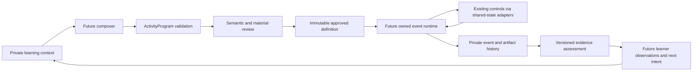

# Sidekick ActivityProgram foundation

This document records the foundation contract and its original milestone boundary. The subsequent [trusted runtime development preview](activity-engine-v2-runtime.md) implements owned persistence and six shared-workspace adapters behind a disabled-by-default development flag. Sections describing later runtime work below remain the original architecture plan; the runtime document identifies what is now implemented and verified. V1 remains the default engine.

Status: architecture and isolated contract implementation. The current Next.js/FastAPI application continues to run `ActivitySpec` 1.0–1.3. No `ActivityProgram` is served to a child, no current session is converted, and no learning-state policy or database migration changes in this task.

## 1. Product contract and boundaries

An activity is a world in which a child can accomplish a mission by using the target concept. The AI chooses a setting, materials, compatible actions and rules around a learning goal grounded in uploaded work and relevant history. A skill does not select one permanent game, template or component family.

A program may keep one play space open throughout, connect several spaces, offer alternative mission routes, or let a child revisit and revise a construction. It needs a clear finish, but does not require a guided phase, a fixed scene count, a universal submit/next loop, or a separate final quiz. A mission can admit several valid constructions. Scoring and the learning objective remain stable while the child experiments or receives help.

Mission completion and evidence of understanding are different records. Saving an original story may finish a mission while its quality awaits parent review. Completing a construction after a demonstration is an assisted outcome, not an independent success. Completion alone never establishes mastery.

This milestone implements the authoritative Pydantic contract, offline validation, original fixtures and tests. A production event runtime, React adapters, AI composition, private event persistence, evidence reducers and next-activity selection are later phases. A successful validation report is not a release authorization or proof that an activity teaches its target.

## 2. Current constraints, traced to the implementation

The baseline is commit `26be828`, merged PR #8. These constraints are application behavior rather than only prompt wording.

| Constraint | Actual enforcement | Keep or replace |
| --- | --- | --- |
| Linear sequence | [`SceneBase`](../backend/activities/models.py) has `phase` and `nextSceneId`. `ActivitySpec.scenes` permits 3–6 scenes. `ActivitySpec.verify` and `verify_general` require `nextSceneId` to be the next array element, with the last element independent. | Replace this execution contract; retain it for historical sessions. |
| Guided then independent | [`general.COMPOSE_INSTRUCTION`](../backend/activities/general.py) requests 2–5 guided scenes and one fresh independent challenge. `capabilities.validate_activity`, `families.validate_activity` and `validate_coverage` inspect guided scenes and the last scene separately. | Replace as a universal activity shape. Freshness and assistance remain evidence concerns. |
| Universal check/save/next | [`SceneStep`](../components/activity-player.tsx) wraps each control in a form and chooses Check, Save or Next. `ActivityPlayer` sends `submit`, `hint` and `next`. | Reuse individual controls and visual language, replace the orchestration wrapper. |
| Scene cursor | [`service.submit`](../backend/activities/service.py) grades the current scene, saves an attempt, and completes a session upon its independent response. `advance` increments `current_scene`. | Keep old runtime for old definitions; build a separate event-driven program runtime. |
| Fixed compatibility | [`capabilities.mechanics_for`](../backend/activities/capabilities.py) looks up the per-ID map. `validate_activity` applies its mechanics and required guided actions. [`families.validate_coverage`](../backend/activities/families.py) checks response modes/materials, including parent-scored speech and writing. | Reuse curriculum requirements as reviewed guidance. Replace skill-to-mechanic dispatch with capability/material/evidence matching. |
| Limited state links | [`composition.validate_connections` and `resolve_scene`](../backend/activities/composition.py) connect a prior guided output to a later guided input. Independent incoming links are forbidden. Supported links include actual rectangle dimensions, quantity totals, ordered text and saved drafts. | Reuse closed operation semantics and source-state preservation; replace scene-local links with typed shared-state bindings. |
| Automatic grading | [`service._grade`](../backend/activities/service.py), [`families.grade_response`](../backend/activities/families.py), toolkit graders and area-derived keys return a correctness result for a submitted scene. | Reuse exact arithmetic/representation checks behind capability adapters. Evidence is not restricted to one submission or last scene. |
| Help | `service.hint` requires a submitted guided attempt, marks `hint_used`, and appends a hint event. The player forbids independent hints. | Retain assistance recording. Replace phase-based availability with declared, relevant help and conservative evidence attribution. |
| Persistence | [`006_activities.sql`](../backend/migrations/006_activities.sql) stores immutable versions/hashes, owned sessions, attempts and retry reservations. [`007_activity_family_assessment.sql`](../backend/migrations/007_activity_family_assessment.sql) adds private recordings and append-only parent reviews. | Reuse ownership, hashing and idempotency patterns. Add separate program event storage later. Do not reinterpret old rows. |
| Parent assessment | [`assessment.review` and `result_details`](../backend/activities/assessment.py) use the independent attempt and final scene. Pending manual results have `correct:null`. `service.parent_attempt` exposes exact saved material/responses only after parent authorization. | Reuse PIN/ownership and private artifact handling. Extend review to declared evidence/artifact scopes rather than only the final scene. |
| Learning-state separation | [`gap.service._homework_state` and `_recompute`](../backend/gap/service.py) replay uploaded-work evidence only. [`gap.reducer.reduce_state`](../backend/gap/reducer.py) ignores sources other than eligible `homework`; activity submission/review does not call this reducer. | Preserve today. Add a separately versioned activity-evidence policy in a later milestone; never forge homework evidence or revive retired quizzes. |

Existing tests such as [`test_activity_composition_recovery.py`](../backend/tests/test_activity_composition_recovery.py), [`test_composition_models.py`](../backend/tests/test_composition_models.py) and the activity browser journeys assert these behaviors. They are regression protection for the current engine, not evidence that the new contract already has a renderer.

Reusable infrastructure includes FastAPI request boundaries, cookie sessions, active-child checks, account ownership, parent PIN/CSRF enforcement, private file storage, safe provider transport, immutable definition hashes, duplicate-request handling, and Sidekick's existing components, colors, typography and reduced-motion/accessibility conventions. Neither the provider nor the account system needs replacing.

## 3. Architectural split



Only the contract and validation box is implemented here. The diagram describes the target integration, not newly wired application routes.

The immutable definition is separate from mutable session state. A future session pins the definition hash, schema version, capability-registry version, evidence policy and runtime version. State consists only of declared bounded values and server-issued artifact references. Rules cannot modify the definition, objective, help definitions, goals, scoring criteria, ownership, or policy version.

The future child API returns a deliberate public projection: the current visible world, supported actions, mission descriptions, available help and accepted consequences. It does not serialize the complete definition, witness, private assessment predicates/keys, future hidden material or private learning context. The server derives effects, assistance and assessment; a client request cannot award itself a result. Parent review/history uses a separately authorized projection of the exact owned attempt.

Private learning context is assembled by trusted server code from the active child's authorized records. The program contains curriculum intent and categorical observations, not account identifiers, names, uploaded images or private database pointers. Private evidence references are resolved in a separate session/composition record. A curriculum misconception tag is a possibility, not proof that a child has that misconception. Confidence is an explicitly sourced routing estimate, not a diagnosis or calibrated probability.

## 4. ActivityProgram contract

The authoritative executable types live in [`backend/activity_engine_v2`](../backend/activity_engine_v2). A separate schema/version prevents an accidental `ActivitySpec` upgrade from making current sessions execute a different language. There is no dependency from the current API, player or learner reducer into this package.

| Part | Meaning and required relationships |
| --- | --- |
| Learning intent | Known catalog target skills, a concrete learning objective, supported observations and misconception hypotheses with confidence/basis, and observable demonstrations tied to actions/evidence. A target skill is not a game ID. |
| World | Bounded typed state, typed objects and their semantic bindings, real materials, object relationships and supported representations. Missing reading passages, geometry or audio cannot be replaced by a label claiming they exist. |
| Actions | Closed operations with declared input types and a registered capability. The child manipulates quantities, constructions, selections or artifacts; arbitrary code and invented operations are invalid. |
| Rules | Typed conditions and bounded effects, triggered by a child action. Effects update declared shared state; component bindings make the consequences visible. Conditions read data through typed references rather than expression strings. |
| Goals and completion | Mission conditions and a program completion condition independent of assessment. An `any` condition can admit alternative solutions/routes; a construction predicate can admit every valid factor pair rather than one answer key. |
| Help | Relevant predeclared hints, cues or demonstrations. Help retains the objective and assessment criteria, records assistance, and cannot silently become unassisted evidence. |
| Evidence | Observable actions, states, revisions and artifacts linked to target skills; declared automatic checks or parent criteria; assistance attribution. A word count can finish a drafting mission but cannot automatically establish narrative quality. |
| Presentation | Ordered spaces and component groups/bindings, allowed representations and assets. It describes an experience using Sidekick's existing design system, not generated HTML/CSS or a restyled application. |
| Provenance and limits | Schema/capability versions, honest generation/source metadata, immutable content identity and execution/input limits. Fixture authorship is distinct from live generation, semantic review and child testing. |

Full fixtures are executable examples of this contract, not a finite list of future games or a skill whitelist.

### Executable vocabulary

The foundation uses `schemaVersion: "2.0-foundation"` and `componentVersion: "sidekick-program-contract-v1"`. `ActivityProgram` contains `id`, `title`, `definitionVersion`, `intent`, `world`, `components`, `actions`, `rules`, `goals`, `completion`, `help`, `evidence`, `presentation`, `provenance`, `limits`, and an optional offline `witness`. None is a scene phase or universal final-response field.

`intent.targets` names catalog IDs and demonstrations. Observations have an ID, skill, categorical kind/source, confidence and optional sanitized `summary`; `observed_strategy` can capture a reliable strategy rather than only a correctness label. A misconception hypothesis references supporting same-skill observation IDs, so a bare curriculum tag cannot impersonate an observation. This reference check does not authenticate the observation or prove that the hypothesis follows from it. `intent.successEvidence` resolves to evidence covering every declared target.

State slots are closed `integer`, `boolean`, `text`, `choice`, `id_set`, `id_list`, or private-artifact placeholders. Each has an initial value and declared bounds/domain, and may be immutable. Object kinds define required typed bindings, rather than an arbitrary dictionary of generated properties. Objects bind slots; components bind objects and a presentation space. Several compatible tools can therefore act on a shared object without copying a previous scene's answer.

Presentation deliberately uses a minimal layout contract: ordered spaces, an entry space, conditional visibility and ordered components grouped by `spaceId`. A future trusted renderer supplies the responsive Sidekick layout. Physical coordinates, generated CSS and a separate layout language are outside this foundation.

Terms are literal values, state references, current-action input references, or the registered `add`, `subtract`, `multiply`, `count`, `word_count`, and `present` operators. Conditions are comparisons, bounded `all`/`any`/`not`, collection membership, a constant true condition, or a goal reference. In this foundation, a goal cannot reference another goal; completion may reference declared goals. Branches are expressed through shared state and goal/space conditions. Action inputs cannot appear in persistent goals because there is no current action input outside an event.

Effects are `set`, `add_item`, `remove_item`, `toggle_item`, or a same-unit quantity `transfer`. They target declared mutable state only, within the operation's permitted object ports and progress state. Sharing a component does not authorize an equation operation to resize a grid. Every branch must preserve the child's primary input rather than manufacture a correct answer. Visual consequences follow component bindings and space visibility; the foundation does not invent a generated toast/HTML effect. An arbitrary string is not an expression, and dotted IDs are opaque identifiers, not property-access programs.

The initial registered action vocabulary is `transfer_quantity`, `toggle_tile`, `resize_rectangle`, `assemble_product`, `replace_text`, `revise_text`, `select_evidence`, `reorder`, `record_voice`, and `draw`. Each must match the component/object capability and the expected input types. This subset deliberately does not pretend to implement every missing operation in the K–5 inventory.

### Contract bounds

The parser accepts at most 262,144 UTF-8 bytes, JSON nesting depth 40 and 20,000 JSON values/nodes. It rejects duplicate JSON keys and non-finite numbers before recursive contract validation. The typed contract further limits a program to 64 state slots, 32 objects, 32 materials, 24 component instances, 32 actions, 64 rules, 16 goals, 16 evidence definitions, 16 help items and 8 spaces. Collections have at most 120 unique domain members, text slots at most 4,000 characters, and integers lie within declared finite bounds inside ±1,000,000. These are implementation bounds, not grade-appropriate difficulty defaults.

Program limits can tighten the maxima: at most 256 child actions, 8 rules and 32 effects per action, and expression depth 8/node count 128. Every effect is bounded again against the destination slot and world invariants during witness checking and in the planned runtime. The parser and semantic checker are both needed: a small JSON document can still reference an impossible state or unsupported automatic assessment.

Arithmetic intermediates have a magnitude limit of 1,000,000,000,000. The foundation uses bounded integers, not a general rational-number or physical-unit algebra. Transfer/conservation units must match; broader fractions, conversions and whole identity need the operations identified in the audit. `word_count` is mechanical whitespace splitting, not a language-quality score. Future adapters must match the versioned server's Unicode string and set/list semantics rather than silently changing them.

## 5. Bounded rule semantics

The language is declarative JSON interpreted only by trusted application code. It has no generated JavaScript/Python/HTML, `eval`, dynamic imports, regex programs, arbitrary selectors, remote network access or filesystem expressions. Object and state references resolve against the declared world. Unknown operators, effects, capabilities and references are rejected. Plain text remains data and must be escaped by future presentation adapters; it is never interpreted as markup or code.

The future runtime processes one authenticated child action at a time:

1. Verify ownership, active child, pinned definition/version, request ID and expected state revision.
2. Validate the action's input and precondition using declared types/materials and the action's capability.
3. Evaluate applicable rules against the same pre-action snapshot. Apply the bounded effects atomically in documented order; reject out-of-range values, broken invariants or conflicting writes.
4. Derive visible state and mission conditions. Append the accepted action, consequences and assistance context before acknowledging its new revision.
5. Assess eligible declared evidence from accepted events and state. Completion and evidence outcomes are stored separately.

There are no autonomous rule cascades: an effect cannot emit another action or recursively fire a rule. A child can revisit a space or revise repeatedly within declared session bounds; that is not an unbounded reactive loop. A valid bounded execution can still hit its action budget without accomplishing the mission. The eventual runtime must save the state and offer an honest supported exit/restart, not silently change the mission or award success.

The offline validator checks declared types, bounds, initial state and supported computations. A supplied witness is a test trace checked by trusted code; it is not accepted on the author's assertion. A valid witness proves that this trace reaches the mission under the implemented semantics. It does not prove every reachable state is finishable, that there is only one solution, or that a child used the target concept. Absence of a checked witness remains `not_checked`, not “solvable.” No exhaustive general reachability solver is promised. The witness is private validation material, never actual child evidence or an answer script supplied to the child.

Sound relaxed domain checks reject certain impossibilities even without a witness, such as a fixed two-row value required to equal nine or a constant write outside a slot's bounds. Passing those checks proves no action path. Structural acceptance includes these declared-domain consistency checks; the report's `computational` status specifically records the optional finish-witness check. Symbolic relationship declarations, provenance authenticity, concept necessity and exact-skill material sufficiency remain review/host responsibilities.

## 6. Components are capabilities within a world

A component contract identifies semantic inputs/outputs, supported child operations, state changes, compatible connections, required materials/representations, bounds, learning uses and assessable evidence. Compatibility follows port/value types and learning requirements. It does not permanently map a skill to one component.

The new registry distinguishes an operation that exists in a current control from a working v2 shared-state adapter. No v2 adapter is wired by this milestone. A definition can use supported operation semantics and still require an adapter, renderer work, semantic review and child testing before release.

| Existing tool | Reusable behavior | v2 adapter responsibilities and assessment boundary |
| --- | --- | --- |
| Quantity lab / bundle builder | Move conserved pieces among containers; pack/unpack a ten; expose quantities. | Bind to shared quantities/material units, log moves and regrouping, preserve conservation. Exact counts are checkable; strategy claims require evidence/review. |
| Mathematical workspace / area controls | Mark or measure supported boards, cover regions with unit squares, change dimensions, build an expression. | Bind geometry and numeric state, derive calculations from actual constructions, publish typed outputs. A grid click cannot stand in for measurement or an explanation. |
| Sorting / connecting / ordering | Place distinct pieces into groups, connect relationships, arrange a sequence. | Shared object identities and placements replace scene-local answer IDs. Numeric ordering is computable; story order or semantic categories need reviewed content/criteria. |
| Evidence board | Select literal passage evidence and place it with a claim. | Carry the actual selected span/material into an investigation or written response. Checking an offered span ID does not prove an arbitrary inference is correct. |
| Text editor | Create, assemble and revise actual text. | Save artifact revisions, distinguish supplied material from child authorship, and retain before/after text privately. Exact constrained edits can have reviewed keys; original writing needs a parent rubric. |
| Oral studio / drawing studio | Capture actual voice or strokes; play required source text/audio where supported. | Use server-issued private artifact IDs and actual materials. No invented transcript, automatic fluency/phoneme recognition, drawing recognition or automatic essay scoring is available. |
| Fraction controls | Select equal parts, place a fractional point, split parts while preserving the same whole. | Publish exact rational/unit representations and action evidence through an adapter. Preserve the existing visual invariants; do not use a scalar label as a substitute for a required model. |

The [`capability gap inventory`](activity-engine-v2-capability-gaps.md) covers the current K–5 catalog. It separates missing reusable operations from universal migration work and from finished designs. Its candidate operation needs are a review backlog; they are not a new runtime skill gate or evidence of playable coverage.

## 7. Stable help, completion and evidence

Help is allowed throughout an activity when relevant. Its availability can be conditioned on declared world state, but it cannot change a target, grading threshold, accepted construction, rubric or evidence definition. Demonstrations should use a clearly separate preview or explicitly assisted action path. The future runtime records the actual help delivered, including retries, rather than trusting a client-provided `assisted:false`.

Assistance attribution is conservative: relevant help contaminates the corresponding evidence scope until a predeclared genuinely new opportunity establishes otherwise. Dismissing a cue or refreshing the page does not reset it. Whether a later action is a sufficiently new opportunity is an evidence-policy question, not a scene's `independent` label.

Evidence may include meaningful quantities moved, a completed construction, an experiment/comparison, an evidence selection, an explanation, a revision, or an owned private artifact. It names the skills it informs and the demonstrated behavior. Automatic assessment is confined to supported computations and objective representations. Parent review evaluates the actual artifact against the pinned rubric; pending review remains unknown, not incorrect.

A future result contains separate lifecycle/completion, per-criterion assessment and assistance information. It cannot collapse all three into a `correct` boolean. Parent review can add an assessment event without rewriting the child action history or the immutable mission. A review correction is another attributed event, with policy for supersession, rather than an edit to the original evidence.

## 8. Private events and deterministic replay: future integration

The future append-only event envelope should include a server-issued event ID, owned session ID, monotonic sequence/state revision, definition hash, runtime/capability/policy versions, action/help/review kind, declared action or criterion ID, validated payload or private artifact reference, server timestamp and attribution. Client request IDs are unique within a session. The server owns assistance, eligibility and outcome fields.

An accepted child action, rule consequences and state snapshot/checkpoint commit atomically. A retry with the same request ID and identical payload returns the saved result; a different payload conflicts. A stale revision returns an explicit resynchronization response. No database transaction spans provider calls. Replay applies ordered accepted events with the pinned operation semantics, never the latest model-generated rules.

The offline authoring validator currently checks the public K–5 catalog in this checkout. Future approval records must additionally pin its catalog snapshot/hash and review/validation context in trusted storage. Historical replay loads that approved definition and its pinned semantics, rather than rerunning current-catalog authoring acceptance against an older demonstration. Model-declared provenance alone cannot certify who generated or reviewed a definition.

Use separate future tables such as `activity_program_versions`, `activity_program_sessions`, `activity_program_events`, `activity_program_assessments` and `activity_program_evidence`. These names are a migration design, not tables created here. Session rows retain account/child ownership and immutable version foreign keys. Artifacts use the existing private storage/authorized retrieval patterns; published curriculum definitions contain no private file paths or child evidence bodies.

Keep parent PIN checks and ownership checks on every history, artifact and review endpoint; keep active-child/version and CSRF checks on mutations. A hidden route or opaque session ID is not authorization. Child deletion must collect artifact references before cascading records and delete private bytes. Preserve existing upload deletion, export/retention behavior and old activity histories. Logs/audits contain safe codes, versions and internal references, not work, voice, drafts, provider bodies or credentials.

## 9. Learning updates and next-activity selection: future policy

Current uploaded-work observations remain unchanged. The v2 evidence reducer must have its own event source, schema/policy version, idempotent evidence identity and provenance. It must not call `record_homework_evidence` with a fictional question or relabel an activity as homework.

After an activity, a future server pipeline derives per-skill observations from eligible evidence, assistance, material completeness, scorer capability and parent review. An event can support several declared skills, but duplicated actions or replay must not multiply the evidence. Unsupported automatic judgments and pending review abstain. A known misconception remains a confidence-qualified hypothesis with supporting evidence, not an inference from mission completion or a curriculum tag.

Next-activity selection reads those authorized observations and the retained upload history, chooses an evidence-seeking/reinforcement learning intent, and asks for a new compatible composition. It may choose a different action or setting for the same skill. It can respond to help dependence, a fragile representation, successful transfer, an unclear outcome or a parent's review without scheduling a universal quiz.

No mastery threshold or automatic clearing of support observations is introduced here. Before learner-state integration, product policy must specify evidence independence, confidence/weighting, contradictory results, parent-review authority, recency and when support observations change. The current “one eligible wrong uploaded response suggests support” rule remains in force for the current engine. Completion alone is never sufficient for mastery in any policy.

## 10. Validation and release gates

| Gate | What it establishes | What it does not establish |
| --- | --- | --- |
| Structural | Closed schema, known versions/operators/capabilities, valid references/types, bounded input/state/rules, required materials, valid evidence/goal declarations. | Solvability, teaching quality, implemented v2 UI or correct semantic answer keys. |
| Computational | Supported arithmetic/state consistency, conservation checks and checked witness conditions where implemented. Unknown checks stay unknown. | Universal reachability, absence of every soft lock, or conceptual understanding. |
| Semantic review | Future review of exact target necessity, meaningful consequences, suitable materials/content, valid automatic keys/rubrics, achievable finish and relevant help. | Runtime correctness or actual child usability/learning. |
| Integration / child testing | Future real runtime/adapters, owned persistence/replay, accessibility, usability and observed target use. | Broad efficacy or mastery of the whole catalog from a few examples. |

The offline report must keep these gates separate. A declarative automatic check over an artifact's existence or length is not an automatic judgment of the artifact's quality. If the registered scorer cannot establish the requested outcome, reject that automatic assessment or require parent review. Unknown goal feasibility requires further verification; it is not an implicit success.

### API, commands and example checks

```python
from pathlib import Path
from backend.activity_engine_v2 import validate_program

report = validate_program(Path("data/activity_engine_v2/examples/habitat_designer.json").read_bytes())
# report.valid is contract acceptance, not permission to run an activity.
print(report.structural, report.computational, report.semanticReview)
```

`validate_program(payload, check_witness=True)` accepts a JSON byte/string payload, mapping or `ActivityProgram` and returns `ValidationReport`. A rejected contract has safe issue codes/paths without echoing its input. A failed witness reports structural validation separately from computational failure. `require_valid_program` raises a code/path-only `ProgramInvalid` when these offline checks fail. Neither API invokes a model, database, live session, artifact reader or learner reducer.

```sh
npm run activities:v2:examples
npm run activities:v2:validate -- data/activity_engine_v2/examples/habitat_designer.json
npm run activities:v2:schema -- --output /tmp/activity-program.schema.json
backend/.venv/bin/python -m backend.activity_engine_v2 registry --output /tmp/activity-program-components.json
npm run activities:v2:gaps:check
```

The generated JSON Schema describes the structural language. Reference, capability, material, state and assessment checks still require the authoritative validator. The current provider's generic `_strict_schema` transformation is not a v2 generator integration: a future composer must use a provider-compatible closed authoring encoding for bindings/arguments, compile it to this authoritative contract and test that round trip. This task makes no provider-call or live-generation claim for v2.

| Original fixture | Structure and learning need | Validation evidence and limit |
| --- | --- | --- |
| [`observatory_floor.json`](../data/activity_engine_v2/examples/observatory_floor.json) | One persistent tiling/product space for a synthetic adds-the-sides observation; `3.MD.C.7-1`. | Real cell selection must cover the region and match the child-built factors/result. Its witness is a contract trace, not a child performance. |
| [`habitat_designer.json`](../data/activity_engine_v2/examples/habitat_designer.json) | Change rectangle dimensions under fixed stock, then relate the construction to a product; the same skill with a different need/action. | Tests several valid factor pairs and commutation, rather than a single prescribed shape. It does not prove a particular child reasons multiplicatively. |
| [`trail_evidence.json`](../data/activity_engine_v2/examples/trail_evidence.json) | Choose an investigation route and place literal evidence from an original passage; `RL.3.1-1`. | Either defined branch can finish. Literal material/reference checks do not establish semantic support or unique interpretation. |
| [`story_studio.json`](../data/activity_engine_v2/examples/story_studio.json) | Create and revise an opening in a persistent editor; `W.3.3-1`. | A changed real draft finishes the mission while the writing evidence requires parent assessment. Word count is not a quality score. |

All four are original, hand-authored synthetic contract fixtures, not AI-generated activities, production templates, approved semantic lessons or child-tested results. They contain no real student work. Their source observations and witness artifacts are synthetic too. Help is declared without modifying goals or assessment; actual help delivery and assistance attribution require the future owned event runtime.

### Verification of this foundation

The full backend regression suite passed: **1,514 tests**, with six existing dependency warnings. It covers the new contract, invalid references/types/operators/materials, conservation and input preservation, rule budgets, impossible goals, assessment restrictions, alternate fixture solutions and safe diagnostics. Subprocess isolation checks confirm that validation makes no provider/database calls and the live application neither imports nor registers v2. The example CLI checks all four witnesses, and the audit freshness check covers all 795 current K–5 subskills. These checks do not constitute semantic review, runtime integration or child testing.

```sh
backend/.venv/bin/python -m pytest backend/tests -q --tb=short \
  -o tmp_path_retention_policy=failed -o tmp_path_retention_count=1
```

The temporary-directory options discard successful tests' generated databases to keep this catalog-wide regression run within local disk limits. No new environment variables, dependencies or migration are required.

## 11. Phased implementation and acceptance criteria

| Phase | Deliverable | Acceptance before enabling the next phase |
| --- | --- | --- |
| Foundation — this PR | Isolated schema/registry/validator, honest fixtures, negative/positive tests and this specification. | Examples validate; invalid refs/types/operators/materials/assessment/bounds are rejected; current application regression checks pass; no live route imports the new module. |
| Trusted runtime | Deterministic child-action reducer, bounded rules, mission evaluation, help/evidence events, capability adapters and existing Sidekick presentation. | Persistent/branching examples run without universal phases; multiple valid solutions work; criteria remain stable; invalid/stale inputs and budget exhaustion are safe. |
| Event persistence and parent review | Owned immutable program versions, append-only event/artifact storage, checkpoints/replay and scoped parent assessments. | Refresh, duplicate requests, concurrency, profile switch/deletion and replay are tested; every artifact/review stays behind account/PIN boundaries; old sessions still use the old engine. |
| Composition and review | AI output through the same authoritative contract, typed capability retrieval, bounded localized repair and explicit semantic/material review. | Generate materially different experiences for the same intent, without reading a fixed game ID from a skill map; unsupported operations abstain; no raw private work enters logs. |
| Evidence and learner policy | Versioned per-skill observations using actions, constructions, revisions, artifacts and assistance, plus explicit parent outcomes. | Reviewed policy, replay/idempotency and eligibility tests; no completion-only mastery; no fabricated homework; current/old evidence remains attributable. |
| Next-activity selection and pilot | History-aware intent selection, new compositions and staged rollout behind server configuration. | Real upload/history→program→actions/help→assessment→next-intent journeys; accessibility and representative child testing; measured failure/abstention and coverage reports distinguish all gates. |

Introduce these phases behind an engine/version discriminator, with v1 as the unchanged default until a separately reviewed rollout. A fallback preserves the learning intent and supported operations or honestly declines; it does not silently substitute a decorative card. Repair before approval creates a new definition candidate. An active session never receives a silently rewritten objective or scorer.

## 12. Consequential assumptions and open decisions

Assumptions for this foundation: K–5 targets come from the existing catalog; Pydantic is authoritative; generated content is data; original artifacts require parent assessment unless a specifically supported objective scorer exists; the existing design kit is retained; and no current session or learning state is migrated.

Decisions deliberately deferred to the relevant implementation phase include: the parent-facing vocabulary for assisted/partial evidence; how much evidence is sufficient to change support observations; mastery and forgetting policy; whether/how a reviewed parent correction supersedes an earlier review; the exact supported runtime asset/publishing workflow; session expiry and exhausted-budget exits; and the rollout/rollback policy for newly added capabilities. These decisions belong to later phases; this foundation preserves current behavior.
